[English](README.en.md) | [Русский](README.md)

# ЮKassa MCP Payment Agent

[](https://www.typescriptlang.org/)
[](https://nodejs.org/)
[](https://vuejs.org/)
[](https://expressjs.com/)
[](https://mcp.yookassa.ru)
[](LICENSE)
[](https://github.com/alekstar79/ykassa-mcp-integrator/actions/workflows/ci.yml)
[](https://www.npmjs.com/package/@alekstar79/ykassa-mcp)

The service accepts natural-language requests, selects an available YooKassa
MCP tool, and validates the operation before execution. Requests can be sent
through the reference UI, Messenger Gateway (Telegram or MAX), or headless HTTP API.

- **LLM orchestration:** the model maps requests to available tools.
- **Human approval:** risky operations wait for an explicit decision.
- **Multiple clients:** each client has its own brand, allowlist, and limits.
- **Audit log:** MCP calls are written to `logs/mcp-calls.jsonl`.

## Quick start from source

Open a terminal in the project folder and run:

```bash
npm install
npm run setup
npm run start:configurator
```

In the configurator, enter the client and LLM settings, download the archive,
and extract its client folder into the project's `clients/` directory. The
archive contains secrets; do not share it or commit its `.env` file. Skip the
configurator if the client is already configured. The CLI alternative is
`npm run client:init -- my-client`; it prompts only for the YooKassa Shop ID
and MCP token.

LLM settings in `clients/<name>/.env` take precedence over matching values in
the root `.env`. Missing client settings fall back to the root file, so the
root `.env` can contain only `PORT` when all LLM values are set per client.

Run services in separate terminals from the project folder:

The `messenger` command automatically uses the verified Ministry of Digital
Development root certificate for MAX without changing the system certificate
store. TLS verification remains enabled.

```bash
# terminal 1: API
npm start
# terminal 2: Telegram and/or MAX
npm run start:messenger
# terminal 3: Reference UI (optional)
npm run start:web
```

Open the Reference UI at `http://127.0.0.1:5173/?client=my-client`.
Start the configurator with `npm run start:configurator`.

## Run with the CLI

From the installed project, use the local CLI without a global install:

```bash
npm exec -- ykassa-mcp --help
npm exec -- ykassa-mcp start:api
npm exec -- ykassa-mcp start:messenger
```

To run `ykassa-mcp` directly, install the CLI globally:

```bash
npm install --global @alekstar79/ykassa-mcp
ykassa-mcp --help
ykassa-mcp init my-client
ykassa-mcp start:api
ykassa-mcp start:messenger
```

Packages for integrating the components into your application:

```bash
npm i @alekstar79/ykassa-contracts   # types, Zod schema, and palette
npm i @alekstar79/ykassa-api         # headless API
```

Configure the provider and model in the configurator or in
`clients/<name>/.env`. When editing the file manually, put each variable on a
separate line:

```dotenv
LLM_PROVIDER=openai
LLM_MODEL=your-model-name
LLM_BASE_URL=https://your-llm-provider.example/v1
LLM_API_KEY=your-llm-api-key
```

Client `.env` values override matching root `.env` values; unset fields fall
back to the root file.

Node.js 18 or newer is required. Get `YOOKASSA_SHOP_ID` and
`YOOKASSA_MCP_TOKEN` from the YooKassa merchant dashboard under
Settings → Shop. Store them only in `clients/<name>/.env`; never commit that
file.

## Client configuration

Client settings are stored in `clients/<name>/config.yaml`. Available
scenarios are constrained by the configuration, the live MCP tool list, and
the API policy. `create_invoice` is passed to the model when it is listed in
`allowed_scenarios` and `defaults.vat_code` is configured.

| Field                          | Type                                                                      | Default               | Description                                                                                                             |
|--------------------------------|---------------------------------------------------------------------------|-----------------------|-------------------------------------------------------------------------------------------------------------------------|
| `allowed_scenarios`            | `string[]`                                                                | All 7 known MCP tools | Scenarios allowed for the client                                                                                        |
| `approval_threshold`           | `number`                                                                  | `4000`                | Amount in RUB; payments or invoices above it require approval                                                           |
| `require_human_confirmation`   | `boolean`                                                                 | `false`               | `true` requires approval for every risky operation                                                                      |
| `limits.max_messages`          | `number` (1–100)                                                          | `20`                  | Maximum messages in one request                                                                                         |
| `limits.max_attachment_kb`     | `number` (1–1024)                                                         | `100`                 | Maximum attachment size                                                                                                 |
| `defaults.currency`            | `RUB` \| `USD` \| `EUR`                                                   | `RUB`                 | Default currency                                                                                                        |
| `defaults.vat_code`            | `1`–`12`                                                                  | `1`                   | Codes 1–12; the standard rate since 2026 is code 11 (22%). Codes 4/6 (20% and 20/120) remain for cases where applicable |
| `defaults.capture`             | `boolean`                                                                 | `true`                | Default `capture` value                                                                                                 |
| `defaults.return_url`          | `string` (URL), optional                                                  | Not set               | URL to return to after payment                                                                                          |
| `defaults.invoice_expiry_days` | `number` (1–30)                                                           | `30`                  | Invoice expiry in days                                                                                                  |
| `brand.display_name`           | `string`                                                                  | Not set               | Service name shown in the UI                                                                                            |
| `ui.mode`                      | `reference-ui` \| `custom-ui`                                             | `reference-ui`        | Client interface mode                                                                                                   |
| `ui.accent`                    | `navy` \| `terracotta` \| `forest` \| `graphite` \| `cobalt` \| `crimson` | `navy`                | Button and accent color                                                                                                 |
| `ui.radius`                    | `0–24`                                                                    | `2`                   | Corner radius from 0 to 24 px                                                                                           |
| `ui.shadow`                    | `none` \| `soft` \| `medium`                                              | `soft`                | Shadow intensity                                                                                                        |
| `ui.font_pair`                 | `manrope+jetbrains` \| `inter+jetbrains`                                  | `manrope+jetbrains`   | Font pair                                                                                                               |
| `ui.form_style`                | `flat` \| `card`                                                          | `flat`                | Form on the page or in a card                                                                                           |
| `ui.h1_size`                   | `s` \| `m` \| `l`                                                         | `m`                   | Main heading size                                                                                                       |

For `mode: custom-ui`, set only `ui.mode` in YAML. The custom interface uses
the [HTTP contract](docs/api-contract.md).

## Architecture

The API, reference UI, and client interfaces are independent and connected
through the HTTP contract and the `config.yaml` format.

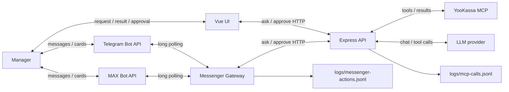

Interactive map — [architecture.html](https://alekstar79.github.io/ykassa-mcp-integrator/architecture.html). It shows the core API, Reference UI, and Messenger Gateway components. Click a node to open its Semantic passport with its purpose, connections, and data flows.

Project presentation (10 slides): [presentation.html](https://alekstar79.github.io/ykassa-mcp-integrator/presentation.html). Headless API overview, architecture without shared imports, `/api/ask → /api/approve` flow, three endpoints for a custom UI, MCP tools and policy, LLM providers, audit and metrics.

- `apps/api` is the headless API: MCP client, LLM orchestration, approvals,
  and audit logging. The `@alekstar79/ykassa-api` package can be used as a
  library.
- `apps/web` is the Vue 3 reference UI. Replace it with a custom client using
  `docs/api-contract.md`.
- `apps/configurator` is a web configurator that creates a client archive
  containing `config.yaml`, `.env`, and `README.md`, including Telegram/MAX
  settings and enabled bot tokens. The archive contains secrets: store it
  securely and do not commit `.env`.
- `apps/messenger` is an independent Telegram and MAX gateway. It uses the API
  HTTP contract, checks sender allowlists, and presents approval cards. LLM and
  MCP logic remain in the API.
- `apps/cli` (`@alekstar79/ykassa-mcp`) provides commands to initialize a
  client, start the API, and serve client interfaces.
- `packages/contracts` (`@alekstar79/ykassa-contracts`) provides shared
  types, a Zod schema, enums, and the accent palette.

Removing `apps/web` does not affect the API. YooKassa integration goes
through MCP; the API retrieves the available tools using `tools/list` for
each request. Start the API and Messenger Gateway in separate terminals. See
the [Messenger guide](apps/messenger/README.md) for bot setup, allowlists, and
chat commands. MAX uses long polling for development and testing; webhook
delivery is not implemented.

### Bot commands

Commands work in an authorized private chat:

- `/start` sends the welcome message. Unknown sender IDs are denied so the
  operator can add them to the allowlist.
- `/help` shows the command list and request guidance.
- `/status` shows the client brand and allowed MCP scenarios.
- `/reset` clears in-memory conversation history. It does not cancel a pending
  approval; use the buttons on that approval card.

Approve or reject a risky operation with the buttons on its Telegram or MAX
approval card. A chat message such as “yes” does not approve it.

## MCP tools

The statuses below refer to the official YooKassa MCP. The API checks tool
availability through `tools/list` at runtime.

| Tool             | Status                                              | Purpose                     |
|------------------|-----------------------------------------------------|-----------------------------|
| `create_payment` | Available                                           | Create a payment            |
| `get_payment`    | Available                                           | Retrieve a payment          |
| `get_payments`   | Available                                           | Retrieve a list of payments |
| `create_invoice` | Available in MCP; passed to model by configuration  | Create an invoice           |
| `get_invoice`    | Available                                           | Retrieve an invoice         |
| `get_refund`     | Available                                           | Retrieve a refund           |
| `get_refunds`    | Available                                           | Retrieve a list of refunds  |

> `create_invoice` is included in the model tool list only when it is present
> in `allowed_scenarios` and `defaults.vat_code` is set. Before calling MCP,
> the API enriches the cart with configured defaults and validates arguments
> against the tool schema.

The official MCP does not provide `create_refund`; issue refunds through the
YooKassa dashboard or API. `capture_payment` and recurring payment creation
are not part of the official tool set.

## Operation approval

`create_payment` above `approval_threshold`, `create_invoice` above that
threshold or with an unknown total, and either operation when
`require_human_confirmation: true` are not executed automatically. A person
approves or rejects the proposal through the reference UI or a Telegram/MAX
card, which calls `/api/approve`. After approval, the API revalidates the
operation against the current client configuration, live `tools/list`, and
`allowed_scenarios`.

## LLM providers

Set these values in the configurator or in `clients/<name>/.env`. Client
values override matching values in the root `.env`; unset values fall back to
the root file. Keep each assignment on its own line.

```dotenv
LLM_PROVIDER=openai
LLM_MODEL=your-model-name
LLM_BASE_URL=https://your-llm-provider.example/v1
LLM_API_KEY=your-llm-api-key
```

| `LLM_PROVIDER` | Variables                                                                   |
|----------------|-----------------------------------------------------------------------------|
| `openai`       | `LLM_API_KEY`, `LLM_MODEL`, optional `LLM_BASE_URL`                         |
| `anthropic`    | `LLM_API_KEY`, `LLM_MODEL`                                                  |
| `google`       | `LLM_API_KEY`, `LLM_MODEL`                                                  |
| `ollama`       | `LLM_MODEL`, optional `LLM_BASE_URL` (defaults to `http://localhost:11434`) |

For production, use an API key from the selected provider. See
[CONTRIBUTING.md](CONTRIBUTING.md) for the local OpenAI-compatible proxy
workflow.

## Audit log

MCP calls are written to `logs/mcp-calls.jsonl` in JSON Lines format:

```json
{"timestamp":"2026-11-13T14:13:19.948Z","shop_id":"<shop-id>","tool":"create_payment","args":{"amount":{"value":"100.00","currency":"RUB"},"description":"Order payment"},"result":"<tool result>"}
```

Each entry contains `timestamp`, `shop_id`, `tool`, `args`, and either
`result` or `error`. The file can contain request and response data, so
restrict access to it.

## Screenshots

`01-08`: Reference UI (themes, mobile screens, approval, result, and English locale).
`09-14`: configurator settings and preview in light, dark, and mobile layouts.

<details>
<summary>Screenshots</summary>

<table>
  <tr>
    <td align="center"><a href="docs/screenshots/01-reference-light-desktop.png">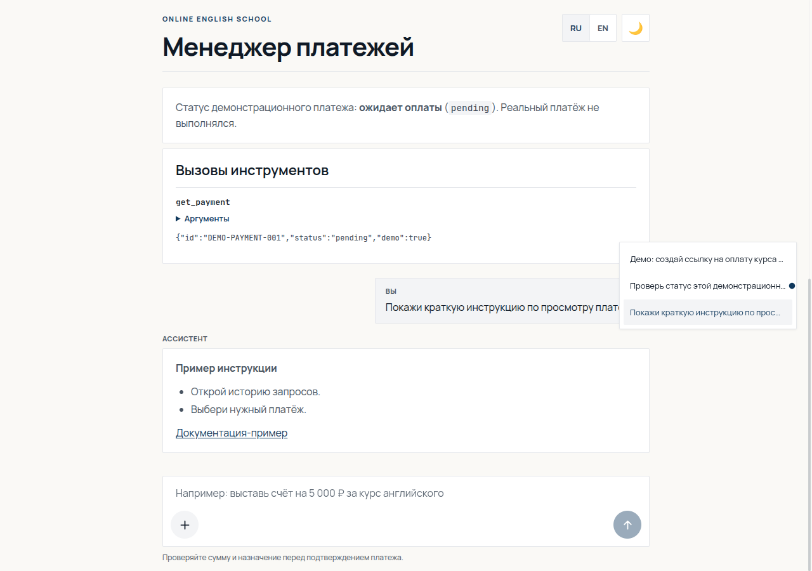</a><br><sub>01. Reference UI · light · desktop</sub></td>
    <td align="center"><a href="docs/screenshots/02-reference-dark-desktop.png">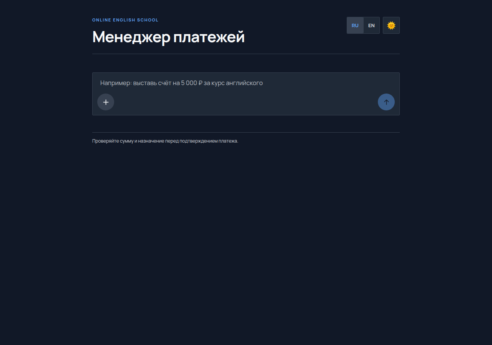</a><br><sub>02. Reference UI · dark · desktop</sub></td>
  </tr>
  <tr>
    <td align="center"><a href="docs/screenshots/03-reference-light-mobile.png">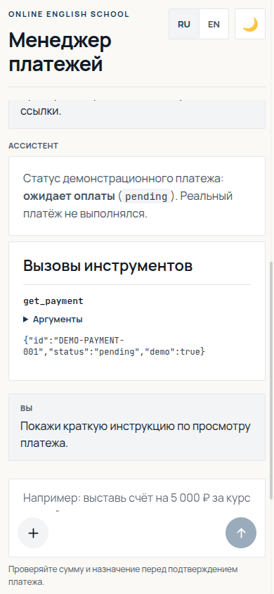</a><br><sub>03. Reference UI · light · mobile</sub></td>
    <td align="center"><a href="docs/screenshots/04-reference-dark-mobile.png">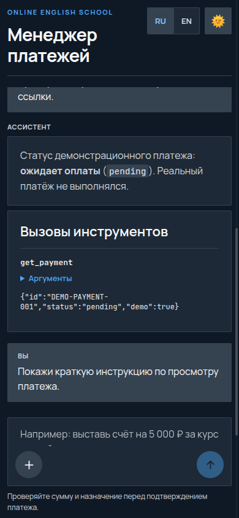</a><br><sub>04. Reference UI · dark · mobile</sub></td>
  </tr>
  <tr>
    <td align="center"><a href="docs/screenshots/05-reference-approval.png">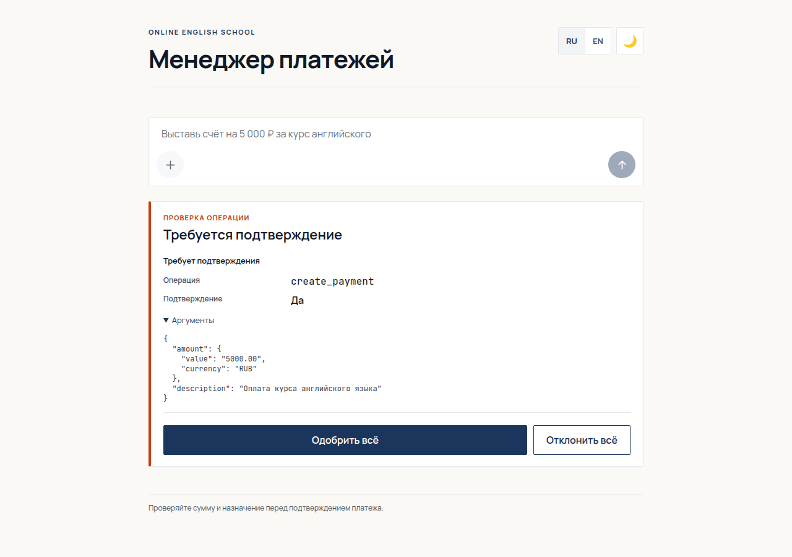</a><br><sub>05. Reference UI · approval</sub></td>
    <td align="center"><a href="docs/screenshots/06-reference-result.png">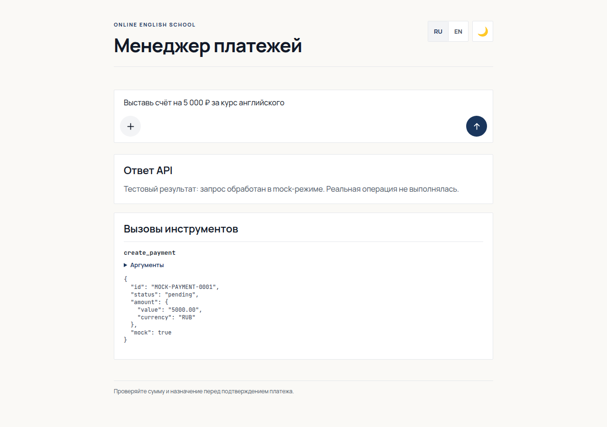</a><br><sub>06. Reference UI · result</sub></td>
  </tr>
  <tr>
    <td align="center"><a href="docs/screenshots/07-reference-settings.png">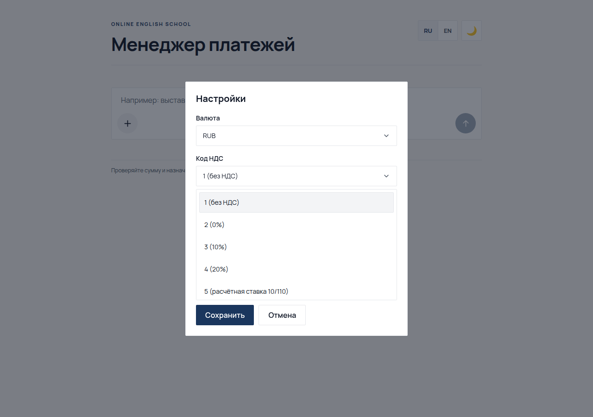</a><br><sub>07. Reference UI · settings</sub></td>
    <td align="center"><a href="docs/screenshots/08-reference-en.png">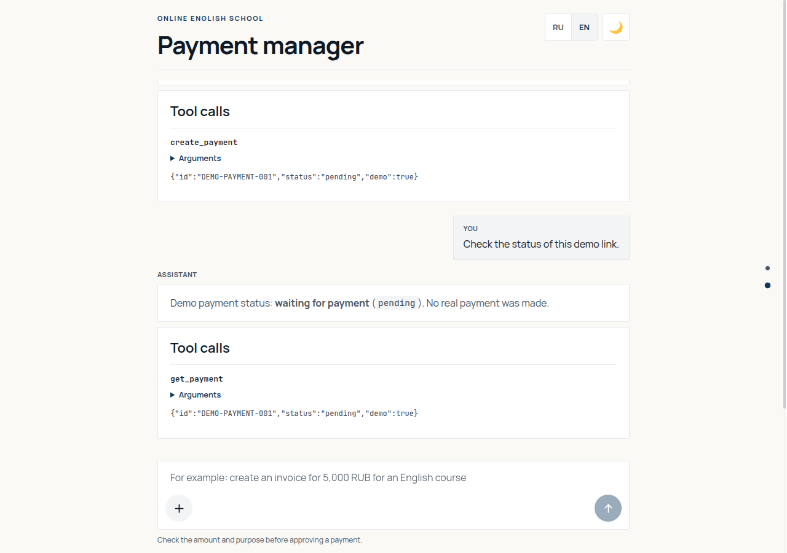</a><br><sub>08. Reference UI · English</sub></td>
  </tr>
  <tr>
    <td align="center"><a href="docs/screenshots/09-configurator-settings-light.png">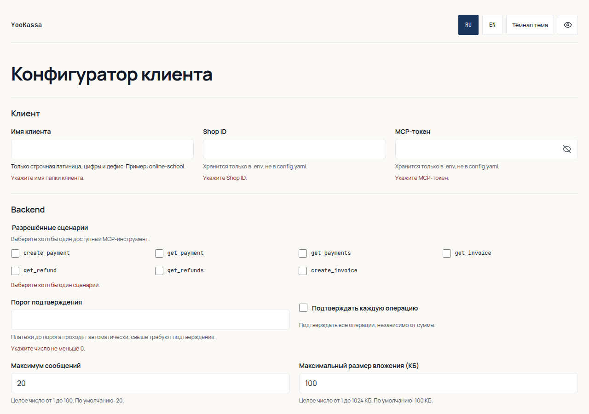</a><br><sub>09. Configurator · settings · light</sub></td>
    <td align="center"><a href="docs/screenshots/10-configurator-settings-dark.png">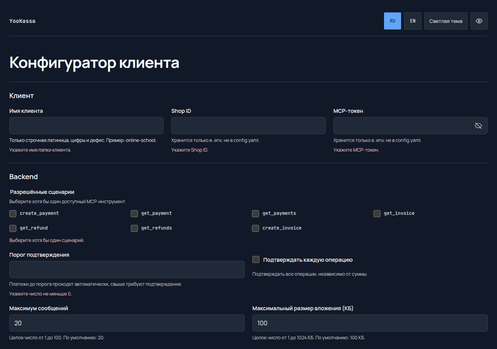</a><br><sub>10. Configurator · settings · dark</sub></td>
  </tr>
  <tr>
    <td align="center"><a href="docs/screenshots/11-configurator-preview-light.png">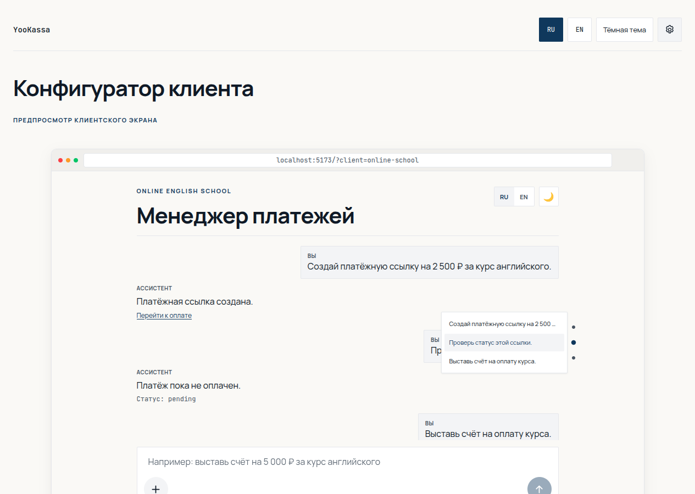</a><br><sub>11. Configurator · preview · light</sub></td>
    <td align="center"><a href="docs/screenshots/12-configurator-preview-dark.png">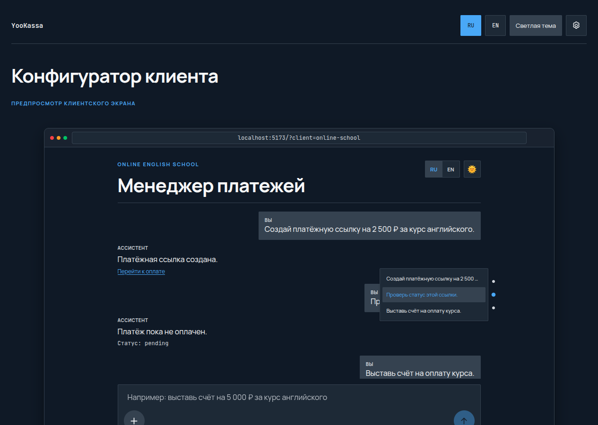</a><br><sub>12. Configurator · preview · dark</sub></td>
  </tr>
  <tr>
    <td align="center"><a href="docs/screenshots/13-configurator-settings-mobile.png">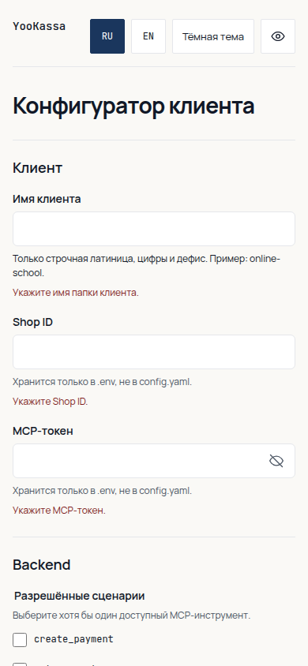</a><br><sub>13. Configurator · settings · mobile</sub></td>
    <td align="center"><a href="docs/screenshots/14-configurator-preview-mobile.png">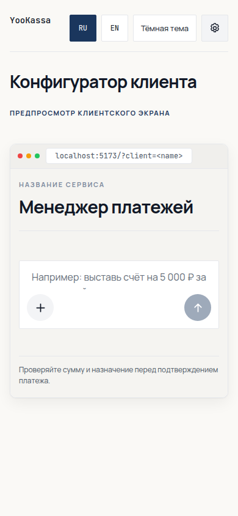</a><br><sub>14. Configurator · preview · mobile</sub></td>
  </tr>
</table>

</details>

## Known limitations

- The reference implementation does not include authentication or RBAC; add
  them before production deployment.
- Pending approvals are stored in memory and are lost when the API restarts.
- The official MCP does not create refunds.

## Production checklist

- JWT and RBAC in front of the API.
- HTTPS on the product domain.
- CORS restricted to the UI domain, not `localhost`.
- An API key from the selected LLM provider.
- Rate limiting on `/api/ask` and `/api/approve`.
- External storage for pending approvals, such as Redis.

## Documentation

- [Contributor guide](CONTRIBUTING.md)
- [Instructions for AI agents](AGENTS.md)
- [Architecture](docs/architecture.md)
- [Messenger Gateway and chat commands](apps/messenger/README.md)
- [HTTP contract](docs/api-contract.md)
- [Local LLM proxy setup](docs/copilot-proxy.md)
- [MIT License](LICENSE)
