[English](README.en.md) | [Русский](README.md)

# ЮKassa MCP Payment Agent

[](https://www.typescriptlang.org/)
[](https://nodejs.org/)
[](https://vuejs.org/)
[](https://expressjs.com/)
[](https://mcp.yookassa.ru)
[](LICENSE)
[](https://github.com/alekstar79/ykassa-mcp-integrator/actions/workflows/ci.yml)
[](https://www.npmjs.com/package/@alekstar79/ykassa-mcp)

The service accepts natural-language requests, selects an available YooKassa
MCP tool, and validates the operation before execution. Requests can be sent
through the reference UI or the headless HTTP API.

- **LLM orchestration:** the model maps requests to available tools.
- **Human approval:** risky operations wait for an explicit decision.
- **Multiple clients:** each client has its own brand, allowlist, and limits.
- **Audit log:** MCP calls are written to `logs/mcp-calls.jsonl`.

## Installation

Run the CLI with `npx`:

```bash
npx @alekstar79/ykassa-mcp init my-client
npx @alekstar79/ykassa-mcp start
npx @alekstar79/ykassa-mcp web
npx @alekstar79/ykassa-mcp configurator
npx @alekstar79/ykassa-mcp --help
```

`start` and `web` / `configurator` run in **separate terminals** (or `start` in the background). Open the reference UI with `?client=<name>`; without it the UI falls back to `online-school`:

```bash
# terminal 1
npx @alekstar79/ykassa-mcp start
# terminal 2
npx @alekstar79/ykassa-mcp web
# browser: http://127.0.0.1:5173/?client=my-client
```

Alternatively, install it globally:

```bash
npm i -g @alekstar79/ykassa-mcp
ykassa-mcp init my-client
```

Packages for integrating the components into your application:

```bash
npm i @alekstar79/ykassa-contracts   # types, Zod schema, and palette
npm i @alekstar79/ykassa-api         # headless API
```

Node.js 18 or newer is required. Get `YOOKASSA_SHOP_ID` and
`YOOKASSA_MCP_TOKEN` from the YooKassa merchant dashboard under
Settings → Shop. Store them only in `clients/<name>/.env`; never commit that
file.

## Client configuration

Client settings are stored in `clients/<name>/config.yaml`. Available
scenarios are constrained by the configuration, the live MCP tool list, and
the API policy. `create_invoice` is currently not passed to the model.

| Field                        | Type                                                                      | Default               | Description                                                            |
|------------------------------|---------------------------------------------------------------------------|-----------------------|------------------------------------------------------------------------|
| `allowed_scenarios`          | `string[]`                                                                | All 7 known MCP tools | Scenarios allowed for the client                                       |
| `approval_threshold`         | `number`                                                                  | `4000`                | Amount in RUB; `create_payment` above this threshold requires approval |
| `require_human_confirmation` | `boolean`                                                                 | `false`               | `true` requires approval for every payment                             |
| `limits.max_messages`        | `number` (1–100)                                                          | `20`                  | Maximum messages in one request                                        |
| `limits.max_attachment_kb`   | `number` (1–1024)                                                         | `100`                 | Maximum attachment size                                                |
| `brand.display_name`         | `string`                                                                  | Not set               | Service name shown in the UI                                           |
| `ui.mode`                    | `reference-ui` \| `custom-ui`                                             | `reference-ui`        | Client interface mode                                                  |
| `ui.accent`                  | `navy` \| `terracotta` \| `forest` \| `graphite` \| `cobalt` \| `crimson` | `navy`                | Button and accent color                                                |
| `ui.radius`                  | `0` \| `2` \| `4` \| `8`                                                  | `2`                   | Element corner radius                                                  |
| `ui.shadow`                  | `none` \| `soft` \| `medium`                                              | `soft`                | Shadow intensity                                                       |
| `ui.font_pair`               | `manrope+jetbrains` \| `inter+jetbrains`                                  | `manrope+jetbrains`   | Font pair                                                              |
| `ui.form_style`              | `flat` \| `card`                                                          | `flat`                | Form on the page or in a card                                          |
| `ui.h1_size`                 | `s` \| `m` \| `l`                                                         | `m`                   | Main heading size                                                      |

For `mode: custom-ui`, set only `ui.mode` in YAML. The custom interface uses
the [HTTP contract](docs/api-contract.md).

## Architecture

The API, reference UI, and client interfaces are independent and connected
through the HTTP contract and the `config.yaml` format.

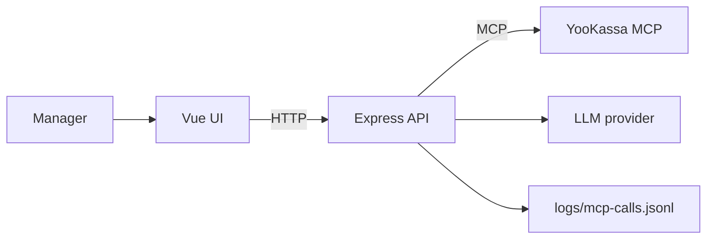

Interactive version of this diagram — [architecture.html](https://alekstar79.github.io/ykassa-mcp-integrator/architecture.html). Click on a node to open its Semantic passport: purpose, connections, data flows. Useful for tracing a request from the manager to MCP and seeing where human-in-the-loop kicks in.

Project presentation (8 slides): [presentation.html](https://alekstar79.github.io/ykassa-mcp-integrator/presentation.html).

- `apps/api` is the headless API: MCP client, LLM orchestration, approvals,
  and audit logging. The `@alekstar79/ykassa-api` package can be used as a
  library.
- `apps/web` is the Vue 3 reference UI. Replace it with a custom client using
  `docs/api-contract.md`.
- `apps/configurator` is a web configurator that creates a client archive
  containing `config.yaml`, `.env`, and `README.md`.
- `apps/cli` (`@alekstar79/ykassa-mcp`) provides commands to initialize a
  client, start the API, and serve client interfaces.
- `packages/contracts` (`@alekstar79/ykassa-contracts`) provides shared
  types, a Zod schema, enums, and the accent palette.

Removing `apps/web` does not affect the API. YooKassa integration goes
through MCP; the API retrieves the available tools using `tools/list` for
each request.

## MCP tools

The statuses below refer to the official YooKassa MCP. The API checks tool
availability through `tools/list` at runtime.

| Tool             | Status                                              | Purpose                     |
|------------------|-----------------------------------------------------|-----------------------------|
| `create_payment` | Available                                           | Create a payment            |
| `get_payment`    | Available                                           | Retrieve a payment          |
| `get_payments`   | Available                                           | Retrieve a list of payments |
| `create_invoice` | Available in MCP, excluded from the model tool list | Create an invoice           |
| `get_invoice`    | Available                                           | Retrieve an invoice         |
| `get_refund`     | Available                                           | Retrieve a refund           |
| `get_refunds`    | Available                                           | Retrieve a list of refunds  |

> **Why is `create_invoice` disabled?** The tool accepts a nested `cart`
> containing products, prices, and quantities. Current LLMs do not reliably
> construct this structure, and schema errors cause the call to be rejected.
> The API excludes `create_invoice` from the model tool list even when it is
> present in `allowed_scenarios`. Enabling it requires strict `cart` schema
> validation before calling MCP and a corresponding API policy change.

The official MCP does not provide `create_refund`; issue refunds through the
YooKassa dashboard or API. `capture_payment` and recurring payment creation
are not part of the official tool set.

## Operation approval

`create_payment` operations above `approval_threshold`, or all payments when
`require_human_confirmation: true`, are not executed automatically. The LLM
proposes an operation, and a person approves or rejects it through
`/api/approve`. After approval, the API revalidates the operation against the
current client configuration, live `tools/list`, and `allowed_scenarios`.

## LLM providers

Set the provider and model in the root `.env`:

| `LLM_PROVIDER` | Variables                                                                   |
|----------------|-----------------------------------------------------------------------------|
| `openai`       | `LLM_API_KEY`, `LLM_MODEL`, optional `LLM_BASE_URL`                         |
| `anthropic`    | `LLM_API_KEY`, `LLM_MODEL`                                                  |
| `google`       | `LLM_API_KEY`, `LLM_MODEL`                                                  |
| `ollama`       | `LLM_MODEL`, optional `LLM_BASE_URL` (defaults to `http://localhost:11434`) |

For production, use an API key from the selected provider. See
[CONTRIBUTING.md](CONTRIBUTING.md) for the local OpenAI-compatible proxy
workflow.

## Audit log

MCP calls are written to `logs/mcp-calls.jsonl` in JSON Lines format:

```json
{"timestamp":"2026-11-13T14:13:19.948Z","shop_id":"<shop-id>","tool":"create_payment","args":{"amount":{"value":"100.00","currency":"RUB"},"description":"Order payment"},"result":"<tool result>"}
```

Each entry contains `timestamp`, `shop_id`, `tool`, `args`, and either
`result` or `error`. The file can contain request and response data, so
restrict access to it.

## Screenshots

`01-07`: reference UI (light and dark themes, mobile, English).
`08-12`: client configurator (settings, preview, dark theme, mobile).

<details>
<summary>Screenshots</summary>

<table>
  <tr>
    <td align="center"><a href="docs/screenshots/01-light-desktop.png">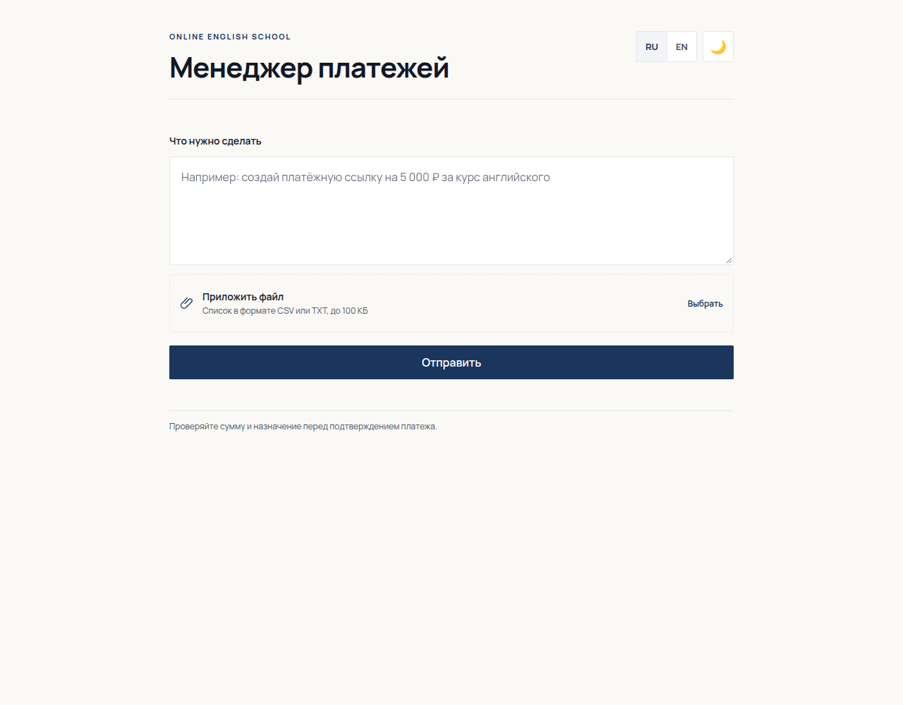</a><br><sub>01. Reference UI · light · desktop</sub></td>
    <td align="center"><a href="docs/screenshots/02-dark-desktop.png">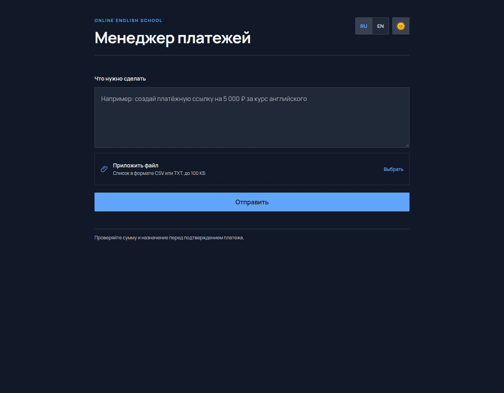</a><br><sub>02. Reference UI · dark · desktop</sub></td>
  </tr>
  <tr>
    <td align="center"><a href="docs/screenshots/03-result-desktop.png">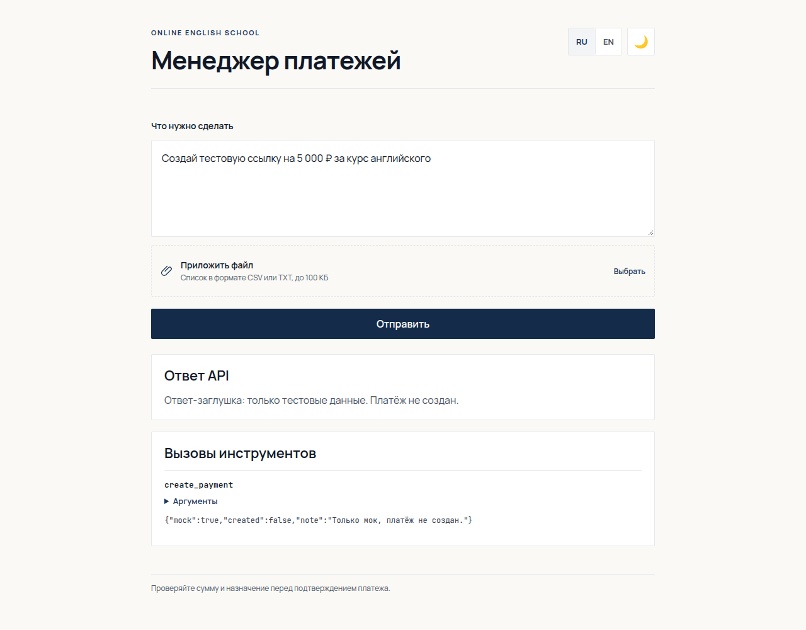</a><br><sub>03. Result and tool calls</sub></td>
    <td align="center"><a href="docs/screenshots/04-approval-desktop.png">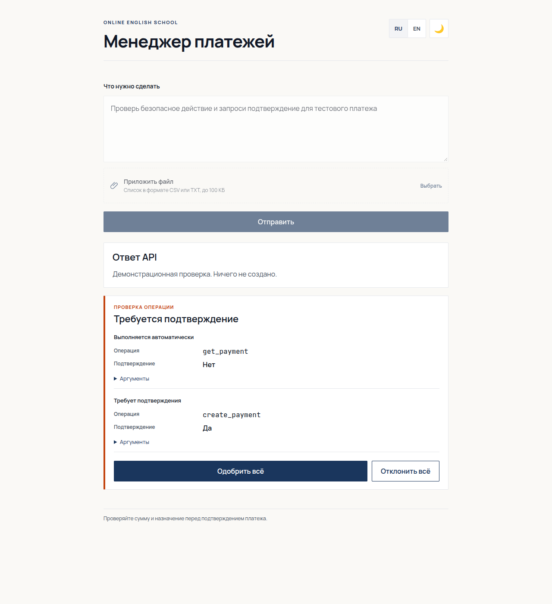</a><br><sub>04. Human-in-the-loop approval</sub></td>
  </tr>
  <tr>
    <td align="center"><a href="docs/screenshots/05-light-mobile.png">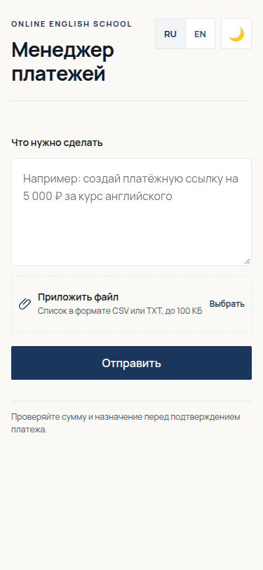</a><br><sub>05. Reference UI · light · mobile</sub></td>
    <td align="center"><a href="docs/screenshots/06-dark-mobile.png">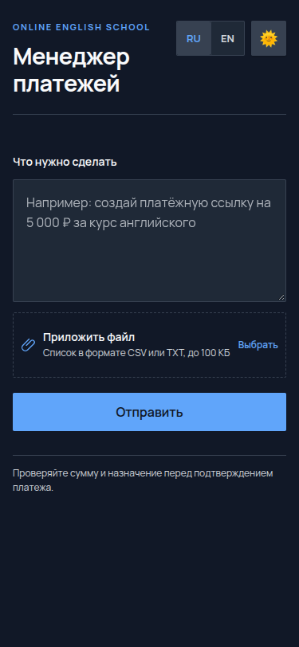</a><br><sub>06. Reference UI · dark · mobile</sub></td>
  </tr>
  <tr>
    <td align="center"><a href="docs/screenshots/07-locale-en.png">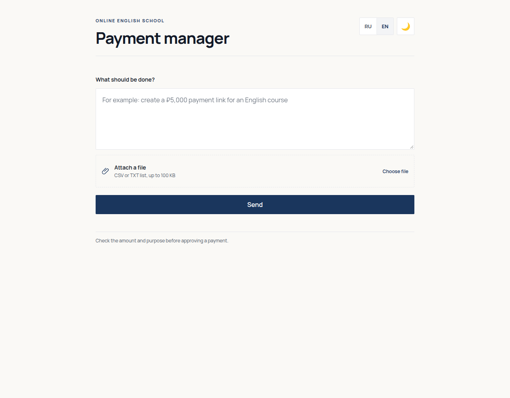</a><br><sub>07. Reference UI · English locale</sub></td>
    <td align="center"></td>
  </tr>
  <tr>
    <td align="center"><a href="docs/screenshots/08-configurator-settings-light-1280.png">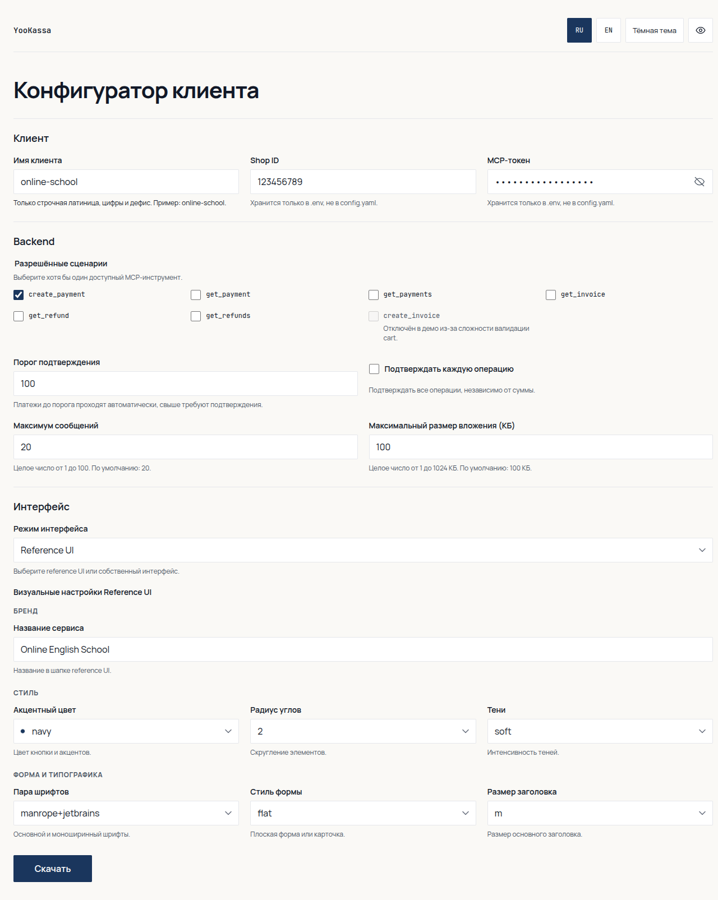</a><br><sub>08. Configurator · settings · light</sub></td>
    <td align="center"><a href="docs/screenshots/09-configurator-preview-light-1280.png">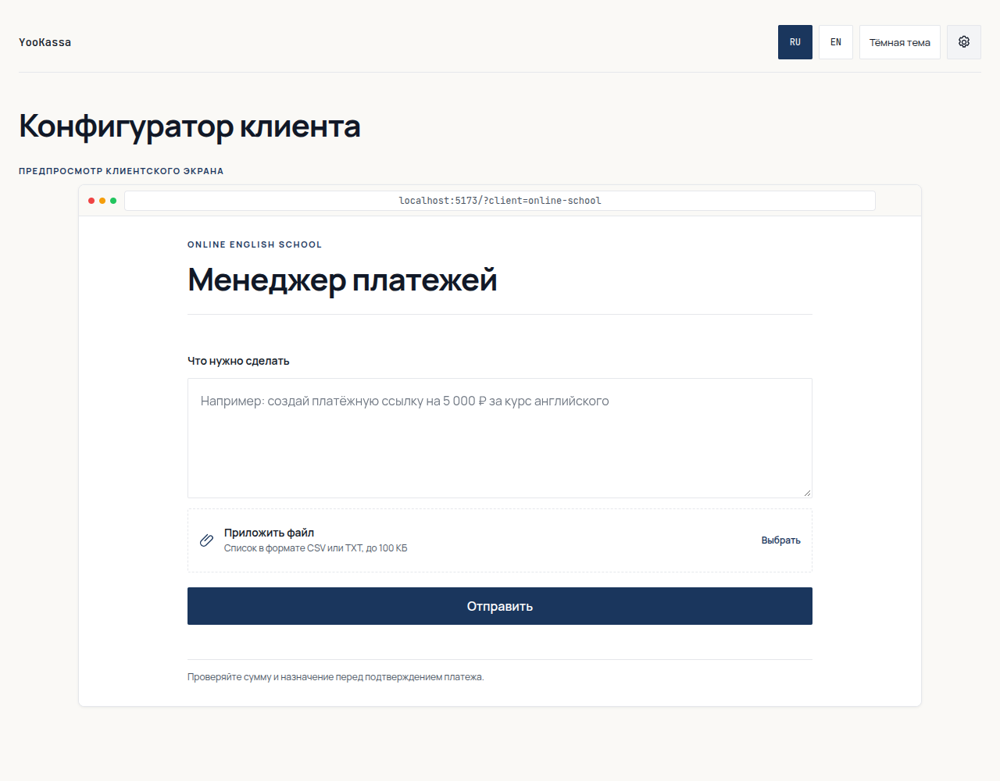</a><br><sub>09. Configurator · preview · light</sub></td>
  </tr>
  <tr>
    <td align="center"><a href="docs/screenshots/10-configurator-settings-dark-1280.png">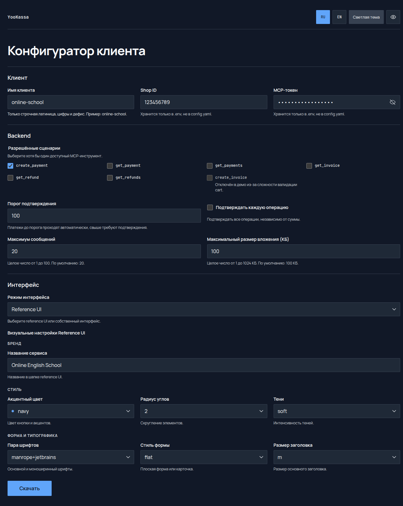</a><br><sub>10. Configurator · settings · dark</sub></td>
    <td align="center"><a href="docs/screenshots/11-configurator-preview-dark-1280.png">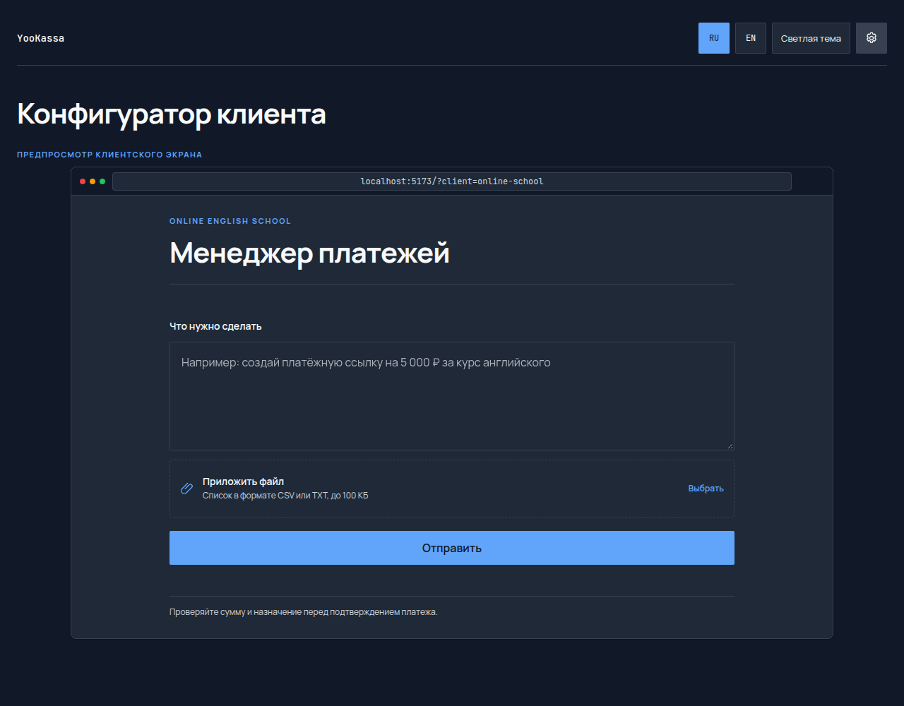</a><br><sub>11. Configurator · preview · dark</sub></td>
  </tr>
  <tr>
    <td align="center"><a href="docs/screenshots/12-configurator-mobile-375.png">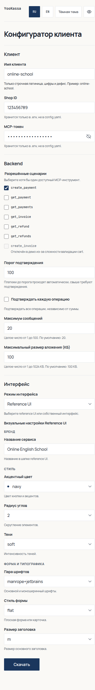</a><br><sub>12. Configurator · mobile</sub></td>
    <td align="center"></td>
  </tr>
</table>

</details>

## Known limitations

- The reference implementation does not include authentication or RBAC; add
  them before production deployment.
- Pending approvals are stored in memory and are lost when the API restarts.
- The official MCP does not create refunds.
- `create_invoice` is not passed to the model until strict `cart` schema
  validation and an API policy update are in place.

## Production checklist

- JWT and RBAC in front of the API.
- HTTPS on the product domain.
- CORS restricted to the UI domain, not `localhost`.
- An API key from the selected LLM provider.
- Rate limiting on `/api/ask` and `/api/approve`.
- External storage for pending approvals, such as Redis.

## Documentation

- [Contributor guide](CONTRIBUTING.md)
- [Instructions for AI agents](AGENTS.md)
- [Architecture](docs/architecture.md)
- [HTTP contract](docs/api-contract.md)
- [Local LLM proxy setup](docs/copilot-proxy.md)
- [MIT License](LICENSE)
