[English](README.en.md) | [Русский](README.md)

# YooKassa MCP Payment Agent


Сервис принимает запросы на естественном языке, выбирает доступный инструмент
YooKassa MCP и проверяет операцию перед выполнением. Запросы можно отправлять
через reference UI или headless HTTP API.

- **LLM-оркестрация:** модель сопоставляет запрос с доступными инструментами.
- **Подтверждение человеком:** рискованная операция ждёт явного решения.
- **Несколько клиентов:** для каждого клиента задаются бренд, allowlist и лимиты.
- **Журнал операций:** вызовы MCP записываются в `logs/mcp-calls.jsonl`.

## Установка

CLI через `npx`:

```bash
npx @alekstar79/ykassa-mcp init my-client
npx @alekstar79/ykassa-mcp start
npx @alekstar79/ykassa-mcp web
npx @alekstar79/ykassa-mcp configurator
npx @alekstar79/ykassa-mcp --help
```

`start` и `web` / `configurator` запускаются в **разных терминалах** (или `start` — в фоне). Reference UI открывайте с параметром `?client=<name>`, иначе он попытается загрузить `online-school` по умолчанию:

```bash
# терминал 1
npx @alekstar79/ykassa-mcp start
# терминал 2
npx @alekstar79/ykassa-mcp web
# браузер: http://127.0.0.1:5173/?client=my-client
```

Альтернативно, глобальная установка:

```bash
npm i -g @alekstar79/ykassa-mcp
ykassa-mcp init my-client
```

Пакеты для интеграции в собственное приложение:

```bash
npm i @alekstar79/ykassa-contracts   # типы, Zod-схема и палитра
npm i @alekstar79/ykassa-api         # headless API
```

Требуется Node.js 18 или новее. `YOOKASSA_SHOP_ID` и `YOOKASSA_MCP_TOKEN`
можно получить в личном кабинете ЮKassa, в разделе «Настройки → Магазин».
Храни их только в `clients/<name>/.env`; не коммить этот файл.

## Конфигурация клиента

Параметры клиента задаются в `clients/<name>/config.yaml`. Допустимые
сценарии ограничиваются как конфигурацией, так и фактическим списком
инструментов MCP и политикой API. `create_invoice` сейчас не передаётся модели.

| Поле                         | Тип                                                                       | Дефолт                           | Описание                                                           |
|------------------------------|---------------------------------------------------------------------------|----------------------------------|--------------------------------------------------------------------|
| `allowed_scenarios`          | `string[]`                                                                | Все 7 известных MCP-инструментов | Сценарии, разрешённые для клиента                                  |
| `approval_threshold`         | `number`                                                                  | `4000`                           | Сумма в рублях; `create_payment` выше порога требует подтверждения |
| `require_human_confirmation` | `boolean`                                                                 | `false`                          | `true` требует подтверждения любого платежа                        |
| `limits.max_messages`        | `number` (1–100)                                                          | `20`                             | Максимум сообщений в одном запросе                                 |
| `limits.max_attachment_kb`   | `number` (1–1024)                                                         | `100`                            | Максимальный размер вложения                                       |
| `brand.display_name`         | `string`                                                                  | Не задан                         | Название сервиса в интерфейсе                                      |
| `ui.mode`                    | `reference-ui` \| `custom-ui`                                             | `reference-ui`                   | Режим клиентского интерфейса                                       |
| `ui.accent`                  | `navy` \| `terracotta` \| `forest` \| `graphite` \| `cobalt` \| `crimson` | `navy`                           | Цвет кнопок и акцентов                                             |
| `ui.radius`                  | `0` \| `2` \| `4` \| `8`                                                  | `2`                              | Скругление элементов                                               |
| `ui.shadow`                  | `none` \| `soft` \| `medium`                                              | `soft`                           | Интенсивность теней                                                |
| `ui.font_pair`               | `manrope+jetbrains` \| `inter+jetbrains`                                  | `manrope+jetbrains`              | Шрифтовая пара                                                     |
| `ui.form_style`              | `flat` \| `card`                                                          | `flat`                           | Форма на фоне или в карточке                                       |
| `ui.h1_size`                 | `s` \| `m` \| `l`                                                         | `m`                              | Размер основного заголовка                                         |

Для `mode: custom-ui` указывай в YAML только `ui.mode`. Собственный интерфейс
работает по [HTTP-контракту](docs/api-contract.md).

## Архитектура

API, reference UI и клиентские интерфейсы независимы и связаны HTTP-контрактом
и форматом `config.yaml`.

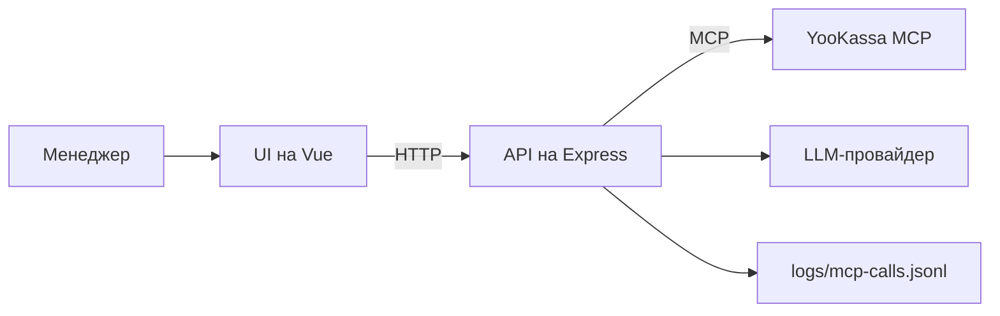

- `apps/api` - headless API: MCP-клиент, LLM-оркестрация, подтверждения и аудит.
  Пакет `@alekstar79/ykassa-api` можно использовать как библиотеку.
- `apps/web` - reference UI на Vue 3. Клиент может заменить его собственным
  интерфейсом, используя `docs/api-contract.md`.
- `apps/configurator` - веб-конфигуратор, который формирует архив клиента с
  `config.yaml`, `.env` и `README.md`.
- `apps/cli` (`@alekstar79/ykassa-mcp`) - команды для настройки клиента,
  запуска API и обслуживания пользовательских интерфейсов.
- `packages/contracts` (`@alekstar79/ykassa-contracts`) - общие типы,
  Zod-схема, перечисления и палитра.

Удаление `apps/web` не влияет на API. Интеграция с YooKassa выполняется через
MCP; при каждом запросе API получает список инструментов через `tools/list`.

## Инструменты MCP

Список ниже относится к официальному YooKassa MCP. API проверяет доступность
инструментов через `tools/list` во время выполнения.

| Инструмент       | Статус                                                 | Назначение                 |
|------------------|--------------------------------------------------------|----------------------------|
| `create_payment` | Доступен                                               | Создание платежа           |
| `get_payment`    | Доступен                                               | Получение платежа          |
| `get_payments`   | Доступен                                               | Получение списка платежей  |
| `create_invoice` | Доступен в MCP, исключён из списка инструментов модели | Создание счёта             |
| `get_invoice`    | Доступен                                               | Получение счёта            |
| `get_refund`     | Доступен                                               | Получение возврата         |
| `get_refunds`    | Доступен                                               | Получение списка возвратов |

> **Почему `create_invoice` отключён.** Инструмент принимает вложенный `cart`
> с товарами, ценой и количеством. Текущие LLM не формируют эту структуру
> надёжно, а ошибки схемы приводят к отклонению вызова. API исключает
> `create_invoice` из списка инструментов модели, даже если он присутствует
> в `allowed_scenarios`. Для его включения потребуется строгая проверка схемы
> `cart` до вызова MCP и соответствующее изменение политики API.

Официальный MCP не предоставляет `create_refund`; возврат оформляется в
личном кабинете ЮKassa или через API. `capture_payment` и создание
рекуррентных платежей не входят в официальный набор инструментов.

## Подтверждение операций

Платежи через `create_payment` выше `approval_threshold` или любые платежи,
если `require_human_confirmation: true`, не выполняются автоматически.
LLM формирует предложение, человек подтверждает или отклоняет его через
`/api/approve`. После подтверждения API повторно проверяет операцию по текущей
конфигурации клиента, актуальному `tools/list` и `allowed_scenarios`.

## LLM-провайдеры

Настрой провайдера и модель в корневом `.env`:

| `LLM_PROVIDER` | Переменные                                                                      |
|----------------|---------------------------------------------------------------------------------|
| `openai`       | `LLM_API_KEY`, `LLM_MODEL`, опционально `LLM_BASE_URL`                          |
| `anthropic`    | `LLM_API_KEY`, `LLM_MODEL`                                                      |
| `google`       | `LLM_API_KEY`, `LLM_MODEL`                                                      |
| `ollama`       | `LLM_MODEL`, опционально `LLM_BASE_URL` (по умолчанию `http://localhost:11434`) |

Для production используй API key выбранного провайдера. Настройка локального
OpenAI-совместимого proxy описана в [CONTRIBUTING.md](CONTRIBUTING.md).

## Журнал аудита

Вызовы MCP записываются в `logs/mcp-calls.jsonl` в формате JSON Lines:

```json
{"timestamp":"2026-11-13T14:13:19.948Z","shop_id":"<shop-id>","tool":"create_payment","args":{"amount":{"value":"100.00","currency":"RUB"},"description":"Order payment"},"result":"<tool result>"}
```

Запись содержит `timestamp`, `shop_id`, `tool`, `args` и `result` либо `error`.
Файл может содержать данные запроса и ответа, поэтому ограничь к нему доступ.

## Скриншоты

`01-07`: reference UI (светлая и тёмная темы, мобильный экран, английский язык).
`08-12`: конфигуратор (настройки, предпросмотр, тёмная тема, мобильный экран).

<table align="center">
  <tr>
    <td align="center"><a href="docs/screenshots/01-light-desktop.png">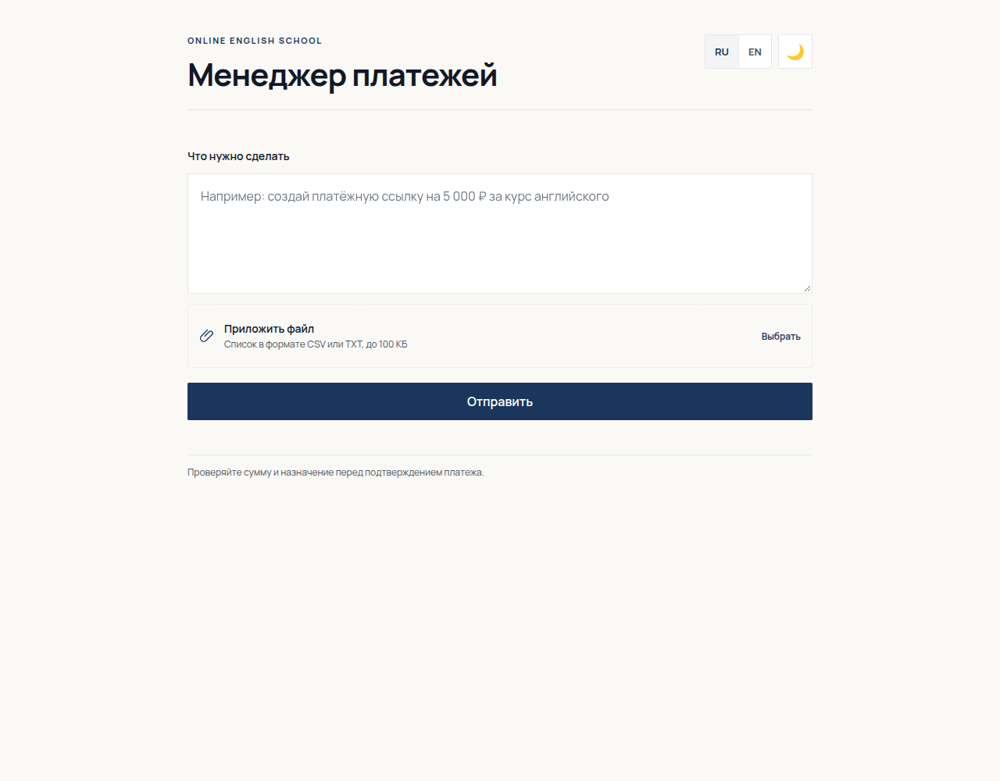</a></td>
    <td align="center"><a href="docs/screenshots/02-dark-desktop.png">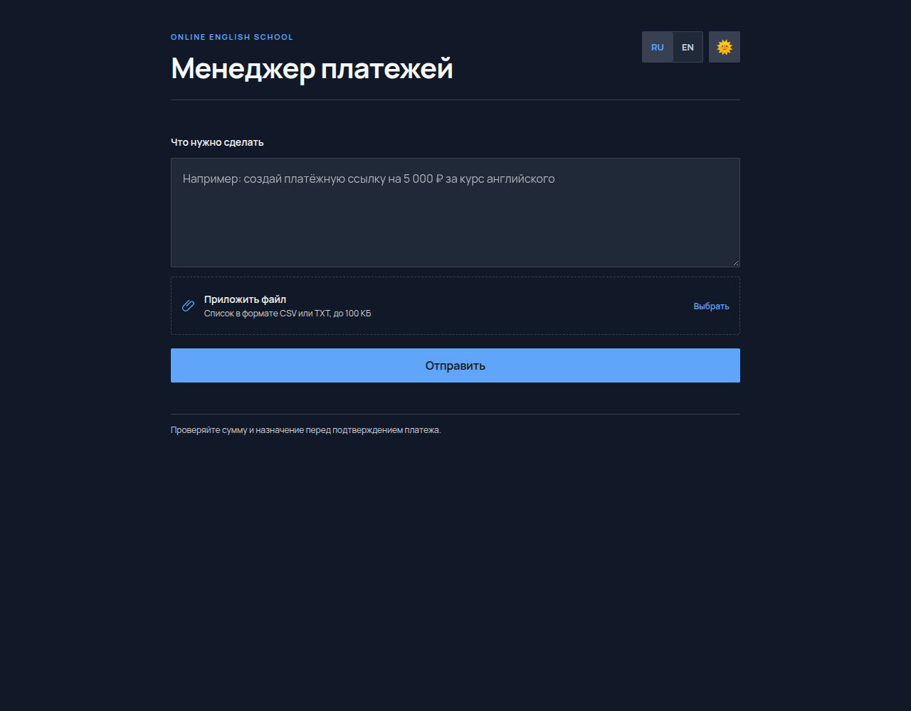</a></td>
    <td align="center"><a href="docs/screenshots/03-result-desktop.png">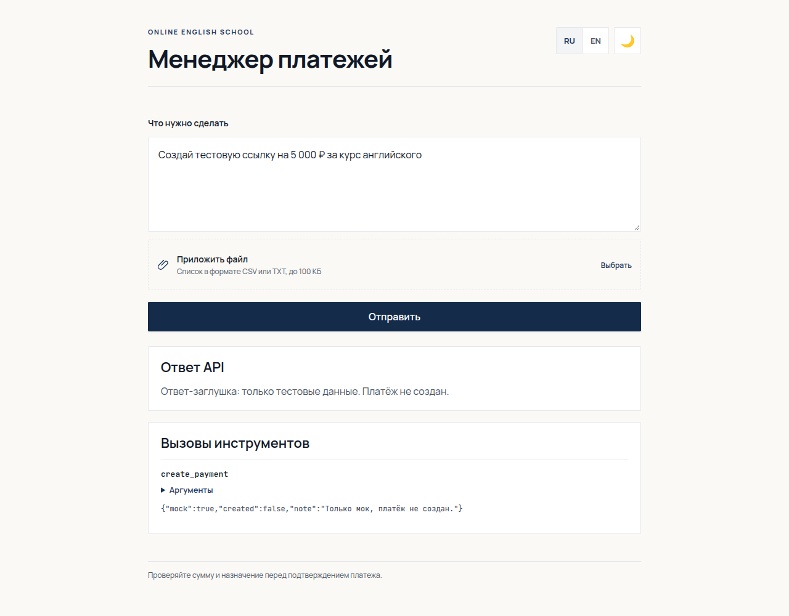</a></td>
  </tr>
  <tr>
    <td align="center"><a href="docs/screenshots/04-approval-desktop.png">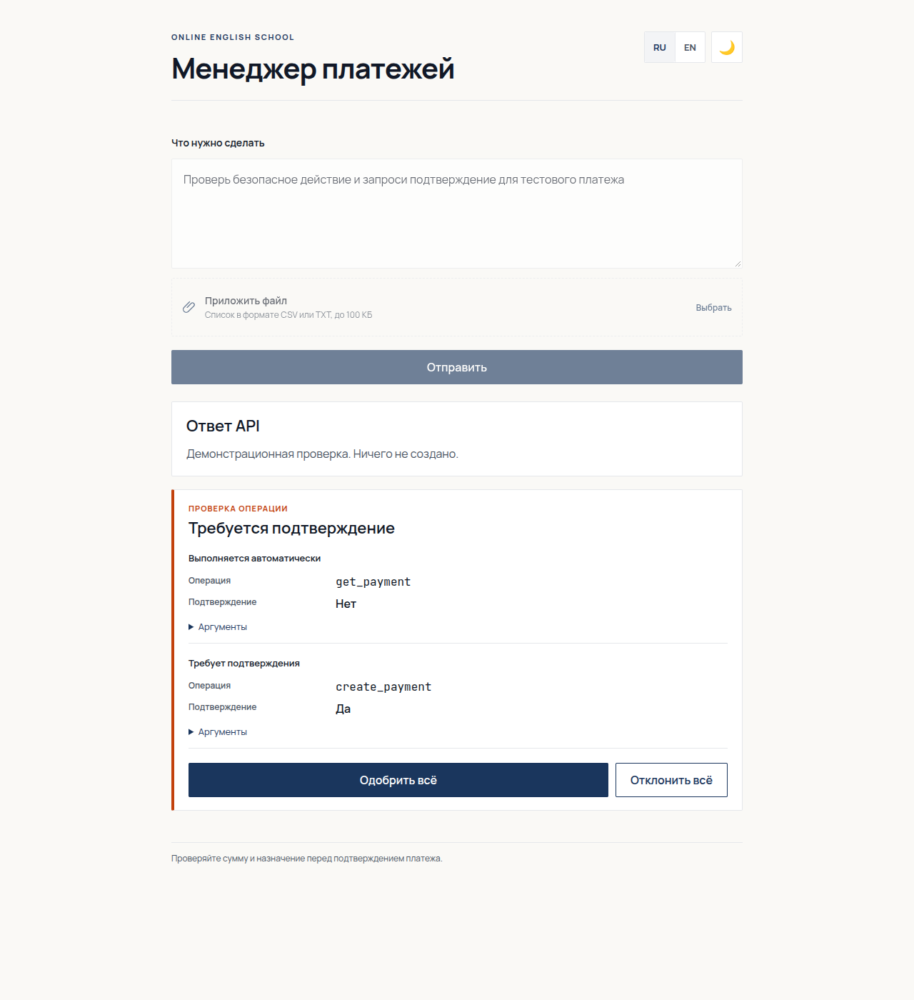</a></td>
    <td align="center"><a href="docs/screenshots/05-light-mobile.png">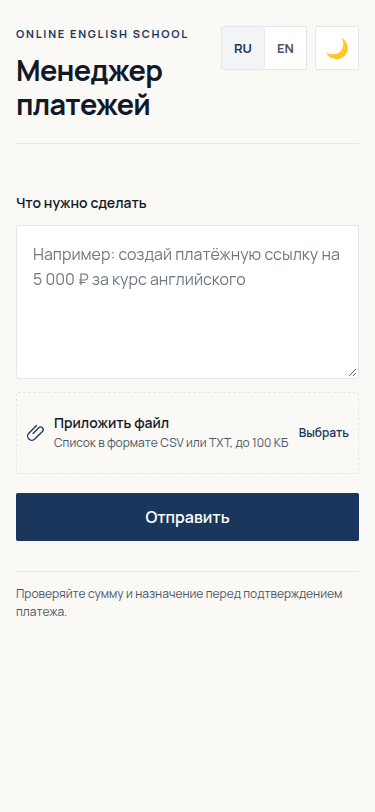</a></td>
    <td align="center"><a href="docs/screenshots/06-dark-mobile.png">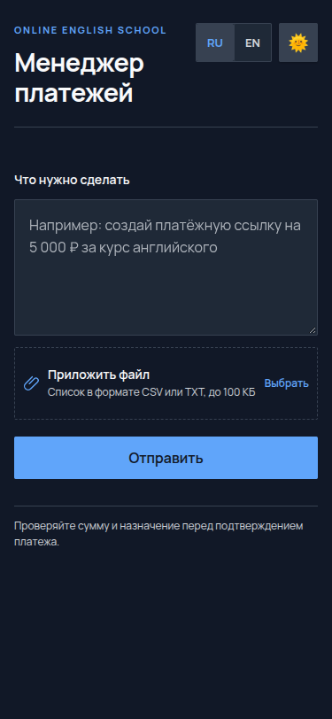</a></td>
  </tr>
  <tr>
    <td align="center"><a href="docs/screenshots/07-locale-en.png">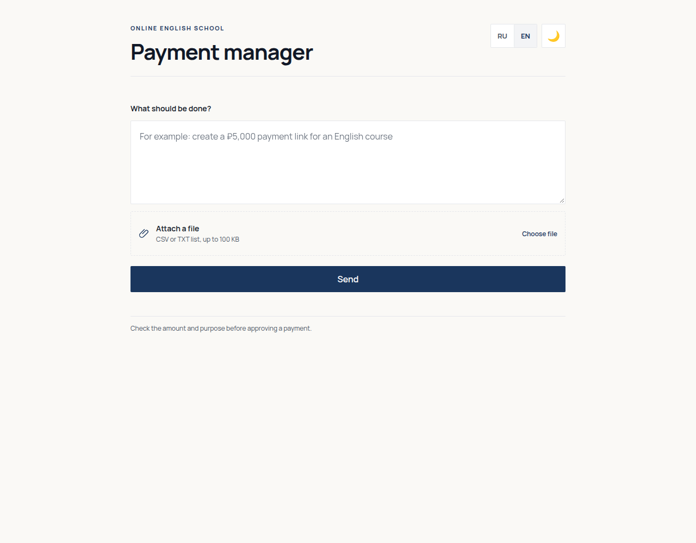</a></td>
    <td align="center"><a href="docs/screenshots/08-configurator-settings-light-1280.png">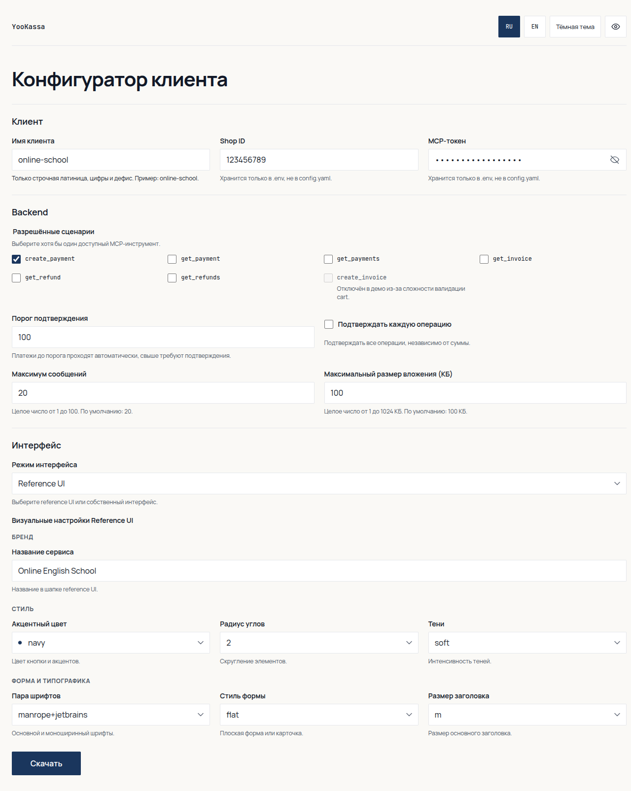</a></td>
    <td align="center"><a href="docs/screenshots/09-configurator-preview-light-1280.png">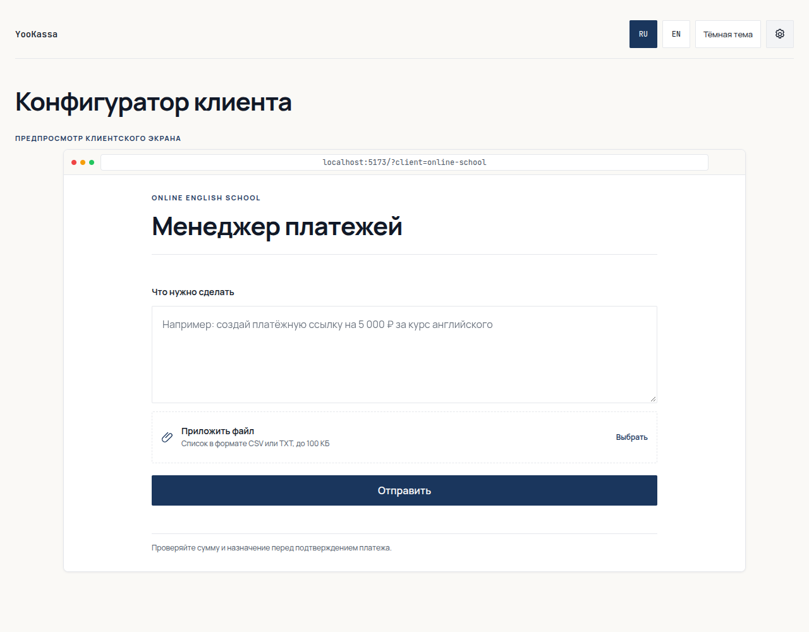</a></td>
  </tr>
  <tr>
    <td align="center"><a href="docs/screenshots/10-configurator-settings-dark-1280.png">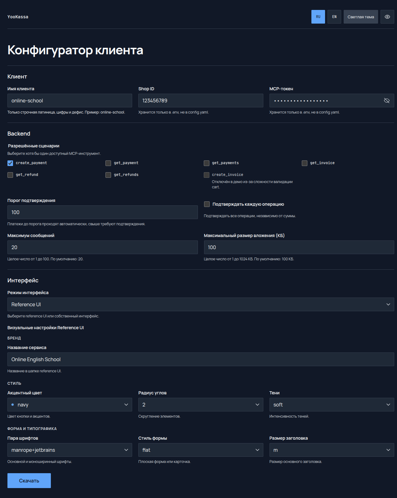</a></td>
    <td align="center"><a href="docs/screenshots/11-configurator-preview-dark-1280.png">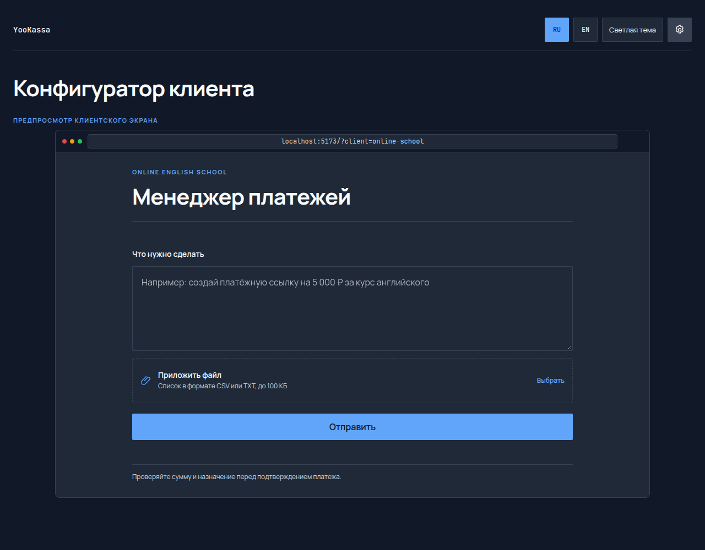</a></td>
    <td align="center"><a href="docs/screenshots/12-configurator-mobile-375.png">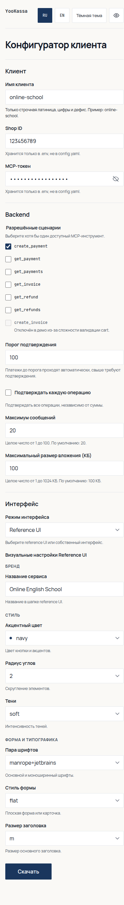</a></td>
  </tr>
</table>

## Известные ограничения

- Reference-реализация не включает аутентификацию и RBAC; добавь их перед
  production-развёртыванием.
- Ожидающие подтверждения хранятся в памяти и теряются при перезапуске API.
- Официальный MCP не создаёт возвраты.
- `create_invoice` не передаётся модели до добавления строгой проверки схемы
  `cart` и обновления политики API.

## Production checklist

- JWT и RBAC перед API.
- HTTPS на домене продукта.
- CORS настроен на домен UI, не на `localhost`.
- API key выбранного LLM-провайдера.
- Rate limiting для `/api/ask` и `/api/approve`.
- Внешнее хранилище для ожидающих подтверждений, например Redis.

## Документация

- [Руководство контрибьютора](CONTRIBUTING.md)
- [Архитектура](docs/architecture.md)
- [HTTP-контракт](docs/api-contract.md)
- [План презентации](docs/demo-plan.md)
- [Метрики](docs/metrics.md)
- [Настройка локального LLM proxy](docs/copilot-proxy.md)
- [Лицензия MIT](LICENSE)
