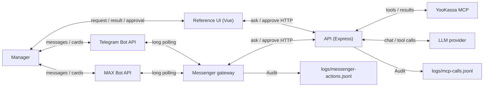

# Architecture

## Components and request flow

The manager sends requests and receives replies and approval results through
the Reference UI. The independent Messenger gateway likewise returns API
results as chat replies or approval cards. Both clients communicate with the
API over HTTP. Telegram and MAX updates and callbacks reach the gateway through
long polling. The gateway applies its private-chat and sender-allowlist checks,
then forwards requests to the API. It does not import API code or implement
LLM, MCP, or payment policy. MAX long polling is limited to development and
testing; production webhook delivery is not implemented.

The API loads the selected client's configuration and secrets, requests the
current MCP tool list, and sends eligible tools and the manager request to the
configured LLM provider. The API validates proposed tool calls and applies the
approval policy before executing payment tools. MCP results are recorded in
the API audit log; messenger events are recorded separately by the gateway.

## Enrichment layer

The LLM parses the manager's intent and proposes tool arguments. Before a call
is sent to MCP, `enrich.ts` fills missing values from the client's `defaults`,
then applies validated per-request `overrides`; overrides take precedence for
that request only. `validateToolCall.ts` checks the resulting arguments
against the tool's JSON Schema returned by `tools/list`. Invalid arguments are
rejected before the MCP call.

The Reference UI stores payment settings locally and sends them as `overrides`
with `/api/ask`. The Configurator does not edit payment defaults: generated
client configuration uses `DEFAULTS_BLOCK_FALLBACK` from the shared contracts.

## Two Representations of the Architecture

This document provides a text-based description, covering components, contracts, and data flows. Additionally, there is an interactive map available here: [architecture.html](https://alekstar79.github.io/ykassa-mcp-integrator/architecture.html).

A third representation—a short presentation for a quick overview—can be found here: [presentation.html](https://alekstar79.github.io/ykassa-mcp-integrator/presentation.html).

The interactive map includes the Messenger gateway alongside the Reference UI
and Headless API. This text and the Mermaid diagram provide additional details
about transports, validation, and component boundaries.

The map and the text complement each other:
- The **text** explains the *why* behind certain decisions (e.g., layer independence, the choice of Zod, and the conditional availability of `create_invoice`).
- The **map** illustrates the *how*—clicking on a node opens a "Semantic passport" that details the component’s purpose, its incoming and outgoing connections, and its data flows.

If you are reading this document for the first time, start with the map; it provides a high-level overview in just 30 seconds.

## Application boundaries

- `apps/api` is headless and does not import either Vue application.
- `apps/web` is one replaceable client. Removing it does not affect the API.
- `apps/messenger` is another replaceable client. It talks to the API only
  through the HTTP contract; Telegram and MAX are implemented transports.
- A custom client can implement its own UI using
  [`docs/api-contract.md`](api-contract.md).
- `apps/configurator` creates client configuration files; it does not depend
  on the API or reference UI.
- `apps/cli` packages commands to initialize clients, start the API, and
  serve the built UI applications.
- `packages/contracts` contains shared types, validation schemas, defaults,
  enums, and palette values.

These components are joined by the HTTP contract and the `config.yaml`
format, not by application-level imports between the API and its clients.

## YooKassa MCP integration

The API uses the YooKassa MCP server as its only payment integration point.
It calls `tools/list` at runtime; the server's current response is the source
of truth for available tools. Client `allowed_scenarios` further narrows the tools offered to the
LLM. `create_invoice` is offered only when it is allowed by the client and
`defaults.vat_code` is set.

## LLM providers

LLM access is replaceable through the `LLM_PROVIDER` setting. The API
supports `openai`, `anthropic`, `google`, and `ollama`. The OpenAI provider
also accepts an OpenAI-compatible base URL, which allows local development
proxies. The proxy is an optional development dependency; production
deployments should use a supported provider endpoint and API key.

## Human approval

1. The LLM proposes one or more tool calls.
2. The API checks each call against the current MCP tools, the client's
   `allowed_scenarios`, and the operation risk policy.
3. If confirmation is required, the API returns the proposal without
   executing it. If the model asks for text confirmation instead of proposing
   an explicit payment or invoice creation, the API retries once with the
   relevant creation tool required.
4. The Reference UI or Messenger gateway presents the approval. A person
   approves or rejects it through `/api/approve`; Telegram and MAX use the
   card buttons, not a free-text reply.
5. On approval, the API reloads the client's configuration and secrets,
   reconnects to MCP, obtains the current tool list, and validates the
   pending calls against the current configuration before execution.

> Поток risky-вызова (UI → API → LLM → approval → MCP) на интерактивной карте подсвечивается кликом по узлу `Headless API`.

Pending approvals are held in memory and expire after 15 minutes. They are
lost when the API process restarts.

The recovery retry currently relies on required tool choice from an
OpenAI-compatible provider. If that is unsupported or the provider does not
return a valid proposal, the API responds with `503`; no payment tool is
executed.

## Client configuration and tenancy

The `?client=<name>` query parameter selects a client in the UI. The UI loads
the public client DTO from `GET /api/clients/<name>/public`. It contains
`brand`, `ui`, `limits`, `allowed_scenarios`, and `approval_threshold`; it
does not contain client secrets.

The API reads the selected client's `config.yaml` and `.env` for each request.
Configuration changes therefore take effect without restarting the API.
Keep `YOOKASSA_SHOP_ID` and `YOOKASSA_MCP_TOKEN` in the client's ignored
`.env` file and restrict its filesystem access where supported.
The Messenger gateway also reads the client's `config.yaml` and `.env` to
load Telegram and MAX enablement, sender IDs, locale, and the corresponding
`TELEGRAM_BOT_TOKEN` or `MAX_BOT_TOKEN`. Messenger settings and tokens are not
part of the public client DTO.

## Audit log

Each MCP tool execution is appended to `logs/mcp-calls.jsonl`. Entries
include a timestamp, tenant `shop_id`, tool name, sanitized arguments, and
either a result or an error. The log may contain request data and should be
protected accordingly.

The gateway writes operational events to
`logs/messenger-actions.jsonl`. It does not log message bodies or tokens.

> Узел `Audit log` на карте показывает, куда стекаются все вызовы MCP.

## Client configurator flow

`clients/example/` is the starting template. A client owner edits settings in
the configurator, downloads an archive containing `config.yaml`, `.env`, and
`README.md`, and places it in `clients/<name>/`. The client UI then loads its
public configuration using `?client=<name>`.
