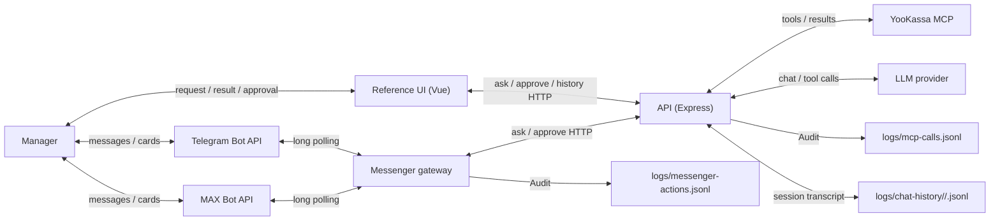

# Architecture

## Components and request flow

The manager sends requests and receives replies and approval results through
the Reference UI. The independent Messenger gateway likewise returns API
results as chat replies or approval cards. Both clients communicate with the
API over HTTP. Telegram and MAX updates and callbacks reach the gateway through
long polling. The gateway applies its private-chat and sender-allowlist checks,
then forwards requests to the API. It does not import API code or implement
LLM, MCP, or payment policy. MAX long polling is limited to development and
testing; production webhook delivery is not implemented.

The API loads the selected client's configuration and secrets and requests the
current MCP tool list. For payment and invoice creation, the API does not expose
the real creation tools to the model. It asks the model for one structured
`prepare_operation` call, then applies the scenario allowlist, server-side
defaults, field policy, and the current MCP JSON Schema. Missing or unsupported
data stops the operation before MCP. Other operations use the regular
tool-calling path, with the same allowlist and schema validation. MCP results
are recorded in the API audit log; messenger events are recorded separately by
the gateway.

Each `/api/ask` conversation uses a `session_id` returned by the API. The
Reference UI persists it per client, and Messenger keeps it for the active
chat session. User messages, assistant replies, and payment-tool results are
stored in a client-scoped JSONL transcript under `logs/chat-history/`. The
transcript is not sent to the model as an implicit persistent session.
Provider calls are stateless: the API includes system instructions in each
request. The financial planner receives recent session context explicitly, and
the regular workflow can call the API's internal `get_chat_history` tool when a
request refers to earlier conversation context. The API returns recent or
lexically relevant turns from that same client/session; this tool does not call
YooKassa MCP. A follow-up that supplies data requested by the deterministic
financial validator resumes extraction using that history. The Reference UI
reads the full transcript from `GET /api/history` when restoring a session and
keeps its composer fixed below the independently scrollable chat.

## Enrichment layer

For payment and invoice creation, the planner extracts candidate values through
`prepare_operation`; the API, not the model, applies the client's defaults and
validated per-request `overrides`. For other operations, the LLM proposes tool
arguments directly. In both paths, `validateToolCall.ts` checks the final
arguments against the relevant JSON Schema returned by `tools/list`; invalid
arguments are rejected before the MCP call.

The Reference UI stores payment settings locally and sends them as `overrides`
with `/api/ask`. The Configurator does not edit payment defaults: generated
client configuration uses `DEFAULTS_BLOCK_FALLBACK` from the shared contracts.

## Two Representations of the Architecture

This document provides a text-based description, covering components, contracts, and data flows. Additionally, there is an interactive map available here: [architecture.html](https://alekstar79.github.io/ykassa-mcp-integrator/architecture.html).

A third representation—a short presentation for a quick overview—can be found here: [presentation.html](https://alekstar79.github.io/ykassa-mcp-integrator/presentation.html).

The interactive map includes the Messenger gateway alongside the Reference UI
and Headless API. This text and the Mermaid diagram provide additional details
about transports, validation, and component boundaries.

The map and the text complement each other:
- The **text** explains the *why* behind certain decisions (e.g., layer independence, the choice of Zod, and the conditional availability of `create_invoice`).
- The **map** illustrates the *how*—clicking on a node opens a "Semantic passport" that details the component’s purpose, its incoming and outgoing connections, and its data flows.

If you are reading this document for the first time, start with the map; it provides a high-level overview in just 30 seconds.

## Application boundaries

- `apps/api` is headless and does not import either Vue application.
- `apps/web` is one replaceable client. Removing it does not affect the API.
- `apps/messenger` is another replaceable client. It talks to the API only
  through the HTTP contract; Telegram and MAX are implemented transports.
- A custom client can implement its own UI using
  [`docs/api-contract.md`](api-contract.md).
- `apps/configurator` creates client configuration files; it does not depend
  on the API or reference UI.
- `apps/cli` packages commands to initialize clients, start the API, and
  serve the built UI applications.
- `packages/contracts` contains shared types, validation schemas, defaults,
  enums, and palette values.

These components are joined by the HTTP contract and the `config.yaml`
format, not by application-level imports between the API and its clients.

## YooKassa MCP integration

The API uses the YooKassa MCP server as its only payment integration point.
It calls `tools/list` at runtime; the server's current response is the source
of truth for available tools. Client `allowed_scenarios` further narrows the tools offered to the
LLM. `create_invoice` is offered only when it is allowed by the client and
`defaults.vat_code` is set.

## LLM providers

LLM access is replaceable through the `LLM_PROVIDER` setting. The API
supports `openai`, `anthropic`, `google`, and `ollama`. The OpenAI provider
also accepts an OpenAI-compatible base URL, which allows local development
proxies. The proxy is an optional development dependency; production
deployments should use a supported provider endpoint and API key.

## Human approval

1. For payment and invoice creation, the model extracts only the requested
   operation and explicit values through `prepare_operation`; it never calls
   the real creation tool directly. Providers with required-tool support are
   asked to return this structured call. If the provider returns only text or
   an invalid plan, the API fails closed and does not call MCP.
2. The API checks the plan against the client's `allowed_scenarios`, the
   server's field policy, configured defaults, and the live MCP schema.
3. If confirmation is required, the API returns the validated proposal without
   executing it. Otherwise, server code executes the validated MCP call.
4. The Reference UI or Messenger gateway presents the approval. A person
   approves or rejects it through `/api/approve`; Telegram and MAX use the
   card buttons, not a free-text reply.
5. On approval, the API reloads the client's configuration and secrets,
   reconnects to MCP, obtains the current tool list, and revalidates the
   saved arguments. The approved creation operation then executes without a
   second model request.

> Поток risky-вызова (UI → API → LLM → approval → MCP) на интерактивной карте подсвечивается кликом по узлу `Headless API`.

Pending approvals are held in memory and expire after 15 minutes. They are
lost when the API process restarts.

OpenAI-compatible, Anthropic, and Google providers can request a required
structured tool call. The Ollama adapter cannot force tool selection; if it
returns text instead of `prepare_operation`, the API responds with `502` and
does not execute a payment tool. Read-only and lookup operations still use the
regular LLM tool-calling workflow.

## Client configuration and tenancy

At startup the Reference UI requests `GET /api/clients`. The API scans
`clients/` and lists directories containing both `config.yaml` and `.env`,
excluding the example template. If exactly one configured client is available,
the UI loads it automatically. If there are multiple clients, the UI asks the
manager to choose one before loading its public configuration from
`GET /api/clients/<name>/public`. The selected client stays in UI state and is
sent in API request bodies; it is not encoded in the browser URL. The public
client DTO contains `brand`, `ui`, `limits`, `allowed_scenarios`, and
`approval_threshold`; it does not contain client secrets.

The API reads the selected client's `config.yaml` and `.env` for each request.
Configuration changes therefore take effect without restarting the API.
Keep `YOOKASSA_SHOP_ID` and `YOOKASSA_MCP_TOKEN` in the client's ignored
`.env` file and restrict its filesystem access where supported.
The Messenger gateway also reads the client's `config.yaml` and `.env` to
load Telegram and MAX enablement, sender IDs, locale, and the corresponding
`TELEGRAM_BOT_TOKEN` or `MAX_BOT_TOKEN`. Messenger settings and tokens are not
part of the public client DTO.

## Audit log

Each MCP tool execution is appended to `logs/mcp-calls.jsonl`. Entries
include a timestamp, tenant `shop_id`, tool name, sanitized arguments, and
either a result or an error. The log may contain request data and should be
protected accordingly.

The gateway writes operational events to
`logs/messenger-actions.jsonl`. It does not log message bodies or tokens.

> Узел `Audit log` на карте показывает, куда стекаются все вызовы MCP.

## Client configurator flow

`clients/example/` is the starting template. A client owner edits settings in
the configurator, downloads an archive containing `config.yaml`, `.env`, and
`README.md`, and places it in `clients/<name>/`. The API discovers configured
clients when the Reference UI loads; no client query parameter is needed.
